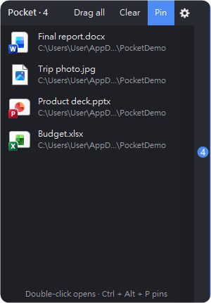
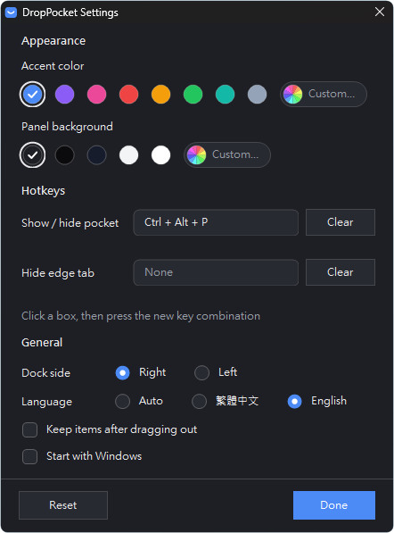

# DropPocket

English | [繁體中文](README.md)

Dragging a file but the window you need is buried? Drop it into the little pocket at the edge of your screen, switch windows, then drag it back out.

A small Windows tool: no install, just a single .exe.

  
  &nbsp;
  

## Features

- **Drop it at the edge**: drag a file onto the small tab at the edge of your screen. The pocket opens, and you let go to drop the file in
- **Drag it back out**: switch to the window you need, hover the tab to open the pocket, and drag items to it. Hold and drag **Drag all** to take everything at once
- **Holds almost anything**: files, folders, text, and "virtual" files such as images from a browser, files inside a zip, or email attachments
- **Leaves your files alone**: dropping a file into the pocket never moves or deletes the original. Dragging out behaves like a normal drag, so the target window decides whether to copy or move
- **Animations**: a drawer-style slide-out, a magnetic tab that grows as you drag closer, and drop and success animations
- **Settings**: accent color, panel background, hotkeys, dock side and language
- **English and Traditional Chinese**: follows your Windows display language by default, and you can switch in Settings
- **Doesn't steal focus**: clicking the pocket never takes focus away from the window you're working in. The pocket remembers its items and position

## Download and run

Download `DropPocket.exe` from [Releases](https://github.com/CW106/DropPocket/releases) and run it.
Works on Windows 10 / 11 and uses the .NET Framework 4 that ships with Windows, so there is nothing else to install.

> The first time you run it, SmartScreen may show "Windows protected your PC". Click "More info → Run anyway".

## How to use it

1. Drag a file onto the small tab at the edge of your screen, and let go once the pocket opens
2. Switch to the window you need
3. Hover the tab to open the pocket, then drag the item to its target

- Double-click an item to open it. Right-click for Open, Show in File Explorer, Copy path / text and Remove from pocket
- Drag the pocket's title bar to move it up or down. Drag it to the other side of the screen to switch edges
- Open Settings from the gear button in the title bar, or from **Settings…** in the system tray menu

## Hotkeys

You can change these in Settings:

| Action | Default |
| --- | --- |
| Show / hide pocket | Ctrl + Alt + P |
| Hide edge tab | None |

## Build it yourself

Run `build.bat`. It uses the .NET Framework compiler that ships with Windows to produce `DropPocket.exe`, so you don't need to install any developer tools.

## Where data is stored

`%LOCALAPPDATA%\DropPocket`

- `items.txt`: the items in the pocket
- `settings.ini`: settings
- `Received\`: temporary copies of virtual files such as browser images. Folders older than three days that are no longer in the pocket are cleaned up automatically

## License

[MIT](LICENSE)
