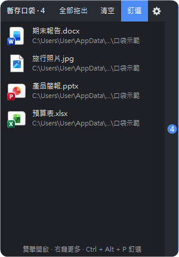
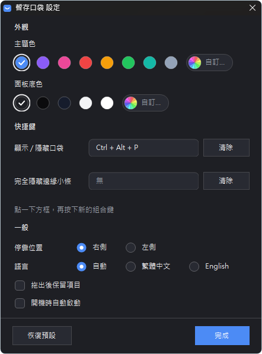

# 暫存口袋 DropPocket

[English](README.en.md) | 繁體中文

拖著檔案時，目標視窗被擋住？先把檔案丟進螢幕邊緣的小口袋，切換好視窗再從口袋拖出來。

一個免安裝、單一 exe 的 Windows 小工具。

  
  &nbsp;
  

## 功能

- **拖到邊緣就收進口袋**：拖著檔案碰一下螢幕邊緣的小條，口袋會自動打開，放開即可放進去
- **切換視窗再拖出來**：滑鼠移到小條上打開口袋，把項目拖到目標視窗；按住「全部拖出」可一次拖出全部
- **什麼都能放**：檔案、資料夾、文字，還有瀏覽器圖片、壓縮檔裡的檔案、郵件附件這類「虛擬檔案」
- **不動你的原檔**：放進口袋不會移動或刪除原檔；拖出去時和平常拖曳一樣，由目標視窗決定複製或移動
- **動畫**：抽屜式展開、拖著檔案靠近時會變大的磁吸小條、放入提示與成功動畫
- **設定視窗**：主題色、面板底色、快捷鍵、停靠位置、語言都能調整
- **中英文介面**：預設跟著 Windows 的顯示語言，也可以在設定裡切換
- **不搶焦點**：點口袋不會讓目前的視窗失去焦點；口袋內容和位置會記住

## 下載與執行

到 [Releases](https://github.com/CW106/DropPocket/releases) 下載 `DropPocket.exe`，直接執行即可。
支援 Windows 10 / 11（使用系統內建的 .NET Framework 4，不需要另外安裝）。

> 第一次執行可能會出現 SmartScreen 的「Windows 已保護您的電腦」，按「其他資訊 → 仍要執行」即可。

## 使用方式

1. 拖著檔案碰一下螢幕邊緣的小條，口袋打開後放開
2. 切換到你要的視窗
3. 滑鼠移到小條上打開口袋，把項目拖到目標

- 雙擊項目：開啟；右鍵：開啟、在檔案總管中顯示、複製路徑 / 文字、從口袋移除
- 拖曳口袋的標題列可以上下移動，拖到螢幕另一側就換邊
- 標題列的齒輪按鈕或系統匣選單的「設定…」可以打開設定

## 快捷鍵

可以在設定視窗裡更改：

| 動作 | 預設 |
| --- | --- |
| 顯示 / 隱藏口袋 | Ctrl + Alt + P |
| 完全隱藏邊緣小條 | 未設定 |

## 自己編譯

執行 `build.bat`，會用 Windows 內建的 .NET Framework 編譯器產生 `DropPocket.exe`，不需要安裝任何開發工具。

## 資料存放位置

`%LOCALAPPDATA%\DropPocket`

- `items.txt`：口袋裡的項目
- `settings.ini`：設定
- `Received\`：瀏覽器圖片等虛擬檔案的暫存，超過三天且已不在口袋裡的會自動清掉

## 授權

[MIT](LICENSE)
